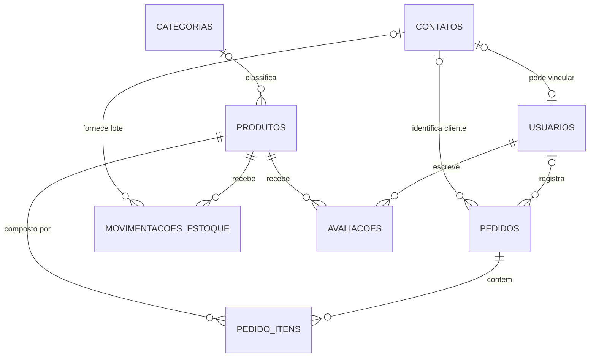

# Modelo entidade-relacionamento

Visão conceitual do banco após `schema.sql`, `etapa4_migracao.sql` e `etapa8_pdv.sql`. As cardinalidades representam as chaves estrangeiras reais; regras de negócio adicionais estão nas observações abaixo.

## Interpretação

- Um contato pode estar vinculado a zero ou um usuário, e um usuário pode ter zero ou um contato: `usuarios.cliente_id` é opcional e único. No domínio, `UsuarioCliente` exige um `Cliente`; o banco não impõe por `CHECK` que o contato vinculado seja do tipo `CLIENTE`.
- Cada pedido pode referenciar zero ou um usuário e zero ou um contato; cada um deles pode estar em vários pedidos. A aplicação associa pedidos de vitrine a um usuário cliente e permite cliente opcional no PDV.
- Um produto pode não ter categoria. Cada item pertence a um pedido e referencia um produto. O serviço exige itens na finalização, embora o banco não imponha um mínimo de itens por pedido.
- Cada movimentação referencia um produto e pode referenciar um contato fornecedor. O banco não valida o tipo do contato; o serviço valida o fornecedor nas entradas de lote.
- Uma avaliação referencia um usuário e um produto; a elegibilidade de pedido entregue é verificada pelo serviço, não por uma chave estrangeira para o pedido. Não há restrição de unicidade de avaliação por produto/usuário no schema.
- As especializações `CLIENTE` e `FORNECEDOR` são representadas por `contatos.tipo` e colunas opcionais na mesma tabela; os perfis de usuário usam `usuarios.perfil`.

## Extensão operacional da v1.6.2

A configuração do expediente é única para toda a loja e não possui chave estrangeira. A disponibilidade pertence ao produto; o nome do entregador, ao pedido de entrega. O item de pedido registra a própria baixa física para permitir a devolução correta em caso de cancelamento. Veja o [modelo lógico](../DL/modelo-logico.md#extensão-operacional-da-v162).

## Extensão de cadastro, personalização e VIP da v1.6.3

As contas de cliente cadastradas com e-mail guardam o mesmo valor no login e continuam vinculadas a um contato. Cada linha da caixa referencia um produto real e guarda as exclusões do grupo de compra. A assinatura aponta para o plano VIP; a mensalidade mantém a referência do plano que originou a cobrança. Veja o [modelo lógico](../DL/modelo-logico.md#extensão-de-cadastro-personalização-e-vip-da-v163).
