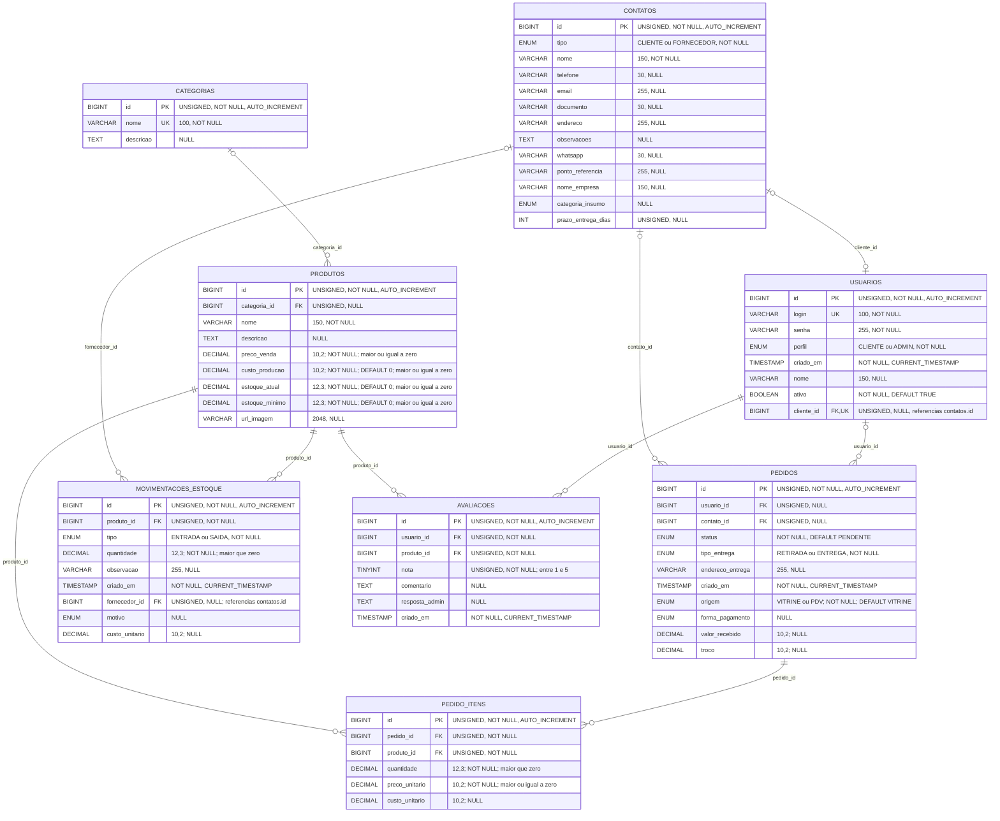

# Modelo lógico do banco

O diagrama principal representa a base após o schema inicial e as migrações das etapas 4 e 8. As extensões da v1.6.2 e da v1.6.3 estão descritas abaixo. `PK` indica chave primária, `FK` chave estrangeira e `UK` unicidade. Os comentários indicam tamanhos, nulidade e valores padrão; todos os IDs são `BIGINT UNSIGNED AUTO_INCREMENT`.

## Domínios e restrições

- `pedidos.status`: `PENDENTE`, `PREPARANDO`, `PRONTO`, `ENTREGUE`, `CANCELADO`.
- `pedidos.forma_pagamento`: `DINHEIRO`, `PIX`, `CARTAO_CREDITO`, `CARTAO_DEBITO` ou `NULL`.
- `contatos.categoria_insumo`: `FARINHA`, `OLEO`, `FRANGO`, `QUEIJO`, `EMBALAGENS`, `BEBIDAS`, `OUTROS` ou `NULL`.
- `movimentacoes_estoque.motivo`: `VENDA`, `LOTE`, `PERDA`, `AJUSTE` ou `NULL`.
- Os checks SQL cobrem preços e estoque não negativos, quantidades positivas e notas de 1 a 5. Outras regras, como o tipo de contato vinculado, endereço de entrega e elegibilidade da avaliação, são aplicadas pelo código.
- A chave `usuarios.cliente_id` é única quando preenchida. Não há `ON DELETE CASCADE` declarado nos scripts.
- Os custos unitários opcionais preservam o desconhecimento de dados históricos anteriores à migração; não devem ser interpretados automaticamente como zero.

## Extensão operacional da v1.6.2

| Tabela | Campos adicionados ou alterados |
|---|---|
| `pedidos` | `status` passa a incluir `SAIU_ENTREGA`; `nome_entregador` é `VARCHAR(100)` opcional. A aplicação permite despachar somente `ENTREGA`, a partir de `PRONTO`. |
| `produtos` | `disponivel_venda BOOLEAN NOT NULL DEFAULT TRUE`, independente do estoque interno. |
| `pedido_itens` | `quantidade_baixada DECIMAL(12,3)` indica a baixa física efetiva. `NULL` identifica itens antigos que baixavam a quantidade integral. |
| `configuracao_loja` | Chave primária `TINYINT` restrita a `1`; `aberta_manualmente` e `respeitar_horario_automatico` padrão `TRUE`; `horario_abertura` e `horario_fechamento` são `TIME` distintos, com padrão `08:00:00` e `23:00:00`. |

## Extensão de cadastro, personalização e VIP da v1.6.3

| Tabela | Campos e regras |
|---|---|
| `usuarios` | `login` passa a `VARCHAR(254)` e permanece único. O novo `email` é único quando preenchido; a restrição exige perfil `CLIENTE` e igualdade exata entre `login` e `email`. Logins legados continuam válidos. |
| `pedido_itens` | `tipo_personalizacao` inclui `COMBO_SIMPLES`, `CAIXA_25`, `CAIXA_40` e `CAIXA_60`. `filtros_caixa` guarda as listas de IDs excluídos em JSON. Os tipos antigos permanecem legíveis. |
| `planos_assinatura` | O único plano ativo permitido é `Clube VIP Ui K'Fomi`, a R$ 99,90 por mês e 15% de desconto. |
| `assinaturas_clientes` e `mensalidades_clube` | A assinatura passa a referenciar o VIP sem reiniciar a vigência. Faturas anteriores continuam ligadas ao plano original, com valor e referência preservados. |
