# Diagrama de classes UML

Visão das principais classes e contratos em `com.salgaderia.app`. Os métodos e relacionamentos apresentados são uma seleção para facilitar a leitura, não um inventário de todos os membros privados. A composição visual não substitui as chaves e cardinalidades do [modelo lógico](../../database/DL/modelo-logico.md).

```mermaid
classDiagram
    class Usuario {
        <<abstract>>
        -Long id
        -String nome
        -String login
        -String senha
        -PerfilUsuario perfil
        -boolean ativo
        +getTelaInicialFxml() String
        +podeAcessarPainelGerencial() boolean
    }
    class UsuarioCliente {
        -Cliente cliente
        +getTelaInicialFxml() String
        +podeAcessarPainelGerencial() boolean
    }
    class UsuarioAdmin {
        +getTelaInicialFxml() String
        +podeAcessarPainelGerencial() boolean
    }
    class Contato {
        <<abstract>>
        -Long id
        -String nome
        -String telefone
        -String observacoes
        +getResumoContato() String
    }
    class Cliente {
        -String whatsapp
        -String endereco
        -String pontoReferencia
        +getResumoContato() String
    }
    class Fornecedor {
        -String nomeEmpresa
        -String cnpj
        -CategoriaInsumo categoriaInsumo
        -int prazoEntregaDias
        +getResumoContato() String
    }
    class Categoria {
        -Long id
        -String nome
        -String descricao
    }
    class Produto {
        -Long id
        -String nome
        -BigDecimal precoVenda
        -BigDecimal custoProducao
        -BigDecimal estoqueAtual
        -BigDecimal estoqueMinimo
        -String urlImagem
        +calcularLucroUnitario() BigDecimal
        +isEstoqueBaixo() boolean
        +adicionarEstoque(BigDecimal quantidade) void
        +removerEstoque(BigDecimal quantidade) void
    }
    class Pedido {
        -Long id
        -StatusPedido status
        -TipoEntrega tipoEntrega
        +getItens() List
        +adicionarItem(PedidoItem item) void
        +removerItem(PedidoItem item) void
        +calcularTotal() BigDecimal
        +transicionarPara(StatusPedido destino) void
    }
    class PedidoItem {
        -Long id
        -BigDecimal quantidade
        -BigDecimal precoUnitario
        +calcularSubtotal() BigDecimal
    }
    class MovimentacaoEstoque {
        -Long id
        -TipoMovimentacaoEstoque tipo
        -BigDecimal quantidade
    }
    class Avaliacao {
        -Long id
        -int nota
        -String comentario
        -String respostaAdmin
        +setNota(int nota) void
    }
    class PedidoFila {
        <<record>>
    }
    class AvaliacaoResumo {
        <<record>>
    }
    class StatusPedido {
        <<enumeration>>
        PENDENTE
        PREPARANDO
        PRONTO
        ENTREGUE
        CANCELADO
        +podeTransicionarPara(StatusPedido destino) boolean
    }
    class FormaPagamento {
        <<enumeration>>
        DINHEIRO
        PIX
        CARTAO_CREDITO
        CARTAO_DEBITO
        +isPermiteTroco() boolean
    }
    class PerfilUsuario {
        <<enumeration>>
        CLIENTE
        ADMIN
    }
    class CategoriaInsumo {
        <<enumeration>>
        FARINHA
        OLEO
        FRANGO
        QUEIJO
        EMBALAGENS
        BEBIDAS
        OUTROS
    }
    class TipoEntrega {
        <<enumeration>>
        RETIRADA
        ENTREGA
    }
    class TipoMovimentacaoEstoque {
        <<enumeration>>
        ENTRADA
        SAIDA
    }

    Usuario <|-- UsuarioCliente
    Usuario <|-- UsuarioAdmin
    Contato <|-- Cliente
    Contato <|-- Fornecedor
    UsuarioCliente "0..*" --> "1" Cliente : cliente
    Produto "0..*" --> "0..1" Categoria : categoria
    Pedido "1" o-- "0..*" PedidoItem : itens
    Pedido "0..*" --> "0..1" Usuario : usuario
    Pedido "0..*" --> "0..1" Cliente : cliente
    PedidoItem "0..*" --> "1" Produto : produto
    MovimentacaoEstoque "0..*" --> "1" Produto : produto
    Avaliacao "0..*" --> "1" Usuario : usuario
    Avaliacao "0..*" --> "1" Produto : produto
    Usuario --> PerfilUsuario
    Fornecedor --> CategoriaInsumo
    Pedido --> StatusPedido
    Pedido --> TipoEntrega
    MovimentacaoEstoque --> TipoMovimentacaoEstoque

    class AutenticacaoService {
        <<interface>>
        +login(String login, String senha) Usuario
        +cadastrar(String nome, String login, String senha, Cliente cliente) UsuarioCliente
    }
    class AgendaService {
        <<interface>>
        +cadastrar(Contato contato) long
        +atualizar(Contato contato) boolean
        +excluir(long id) boolean
        +buscar(FiltroContato filtro, String texto) List
    }
    class ProdutoEstoqueService {
        <<interface>>
        +listar() List
        +entradaLote(long produtoId, long fornecedorId, BigDecimal quantidade, String observacao) void
        +registrarPerda(long produtoId, BigDecimal quantidade, String observacao) void
    }
    class PedidoVendaService {
        <<interface>>
        +finalizar(Pedido pedido) long
        +finalizarPdv(Pedido pedido, FormaPagamento forma, BigDecimal recebido) long
        +transicionar(long pedidoId, StatusPedido destino) void
    }
    class AvaliacaoService {
        <<interface>>
        +salvar(Avaliacao avaliacao) long
        +responder(Usuario admin, long avaliacaoId, String resposta) boolean
        +excluir(Usuario admin, long avaliacaoId) boolean
    }
    class RelatorioFinanceiroService {
        <<interface>>
        +calcular(LocalDateTime inicio, LocalDateTime fim) Relatorio
        +produtosMaisVendidos(LocalDateTime inicio, LocalDateTime fim) Map
        +receitaPorCategoria(LocalDateTime inicio, LocalDateTime fim) Map
    }
    class AutenticacaoServiceImpl
    class AgendaServiceImpl
    class ProdutoEstoqueServiceImpl
    class PedidoVendaServiceImpl
    class AvaliacaoServiceImpl
    class RelatorioFinanceiroServiceImpl
    AutenticacaoService <|.. AutenticacaoServiceImpl
    AgendaService <|.. AgendaServiceImpl
    ProdutoEstoqueService <|.. ProdutoEstoqueServiceImpl
    PedidoVendaService <|.. PedidoVendaServiceImpl
    AvaliacaoService <|.. AvaliacaoServiceImpl
    RelatorioFinanceiroService <|.. RelatorioFinanceiroServiceImpl
    PedidoVendaServiceImpl ..> FormaPagamento

    class UsuarioDAO {
        <<interface>>
    }
    class ContatoDAO {
        <<interface>>
    }
    class CategoriaDAO {
        <<interface>>
    }
    class ProdutoDAO {
        <<interface>>
    }
    class PedidoDAO {
        <<interface>>
    }
    class MovimentacaoEstoqueDAO {
        <<interface>>
    }
    class AvaliacaoDAO {
        <<interface>>
    }
    class UsuarioDAOImpl
    class ContatoDAOImpl
    class CategoriaDAOImpl
    class ProdutoDAOImpl
    class PedidoDAOImpl
    class MovimentacaoEstoqueDAOImpl
    class AvaliacaoDAOImpl
    UsuarioDAO <|.. UsuarioDAOImpl
    ContatoDAO <|.. ContatoDAOImpl
    CategoriaDAO <|.. CategoriaDAOImpl
    ProdutoDAO <|.. ProdutoDAOImpl
    PedidoDAO <|.. PedidoDAOImpl
    MovimentacaoEstoqueDAO <|.. MovimentacaoEstoqueDAOImpl
    AvaliacaoDAO <|.. AvaliacaoDAOImpl
    AutenticacaoServiceImpl --> UsuarioDAO
    AutenticacaoServiceImpl --> ContatoDAO
    AgendaServiceImpl --> ContatoDAO
    ProdutoEstoqueServiceImpl --> ProdutoDAO
    ProdutoEstoqueServiceImpl --> ContatoDAO
    ProdutoEstoqueServiceImpl --> MovimentacaoEstoqueDAO
    PedidoVendaServiceImpl --> PedidoDAO
    PedidoVendaServiceImpl --> ProdutoDAO
    PedidoVendaServiceImpl --> MovimentacaoEstoqueDAO
    AvaliacaoServiceImpl --> PedidoDAO
    AvaliacaoServiceImpl --> AvaliacaoDAO
    AvaliacaoServiceImpl --> UsuarioDAO
    RelatorioFinanceiroServiceImpl --> PedidoDAO
    RelatorioFinanceiroServiceImpl --> MovimentacaoEstoqueDAO

    class LoginController
    class AgendaController
    class ClienteVitrineController
    class AdminDashboardController
    class SelecaoModulosController
    class Navegacao
    class TelaAutenticada {
        <<interface>>
        +definirUsuario(Usuario usuario) void
    }
    TelaAutenticada <|.. ClienteVitrineController
    TelaAutenticada <|.. AdminDashboardController
    TelaAutenticada <|.. AgendaController
    TelaAutenticada <|.. SelecaoModulosController
    LoginController --> AutenticacaoService
    AgendaController --> AgendaService
    ClienteVitrineController --> ProdutoEstoqueService
    ClienteVitrineController --> PedidoVendaService
    ClienteVitrineController --> AvaliacaoService
    AdminDashboardController --> ProdutoEstoqueService
    AdminDashboardController --> PedidoVendaService
    AdminDashboardController --> AgendaService
    AdminDashboardController --> AvaliacaoService
    AdminDashboardController --> RelatorioFinanceiroService
    Navegacao ..> TelaAutenticada

    class ConnectionFactory {
        +getConnection() Connection
        +executarEmTransacao(OperacaoTransacional operacao) T
        +fechar() void
    }
    class EstoqueInsuficienteException
    class AutenticacaoInvalidaException
    class AvaliacaoNaoPermitidaException
    class PersistenciaException
    Produto ..> EstoqueInsuficienteException
    AutenticacaoServiceImpl ..> AutenticacaoInvalidaException
    AvaliacaoServiceImpl ..> AvaliacaoNaoPermitidaException
    ConnectionFactory ..> PersistenciaException
```

`PedidoFila` e `AvaliacaoResumo` são projeções (`record`) usadas para exibição administrativa. `PedidoItem` é imutável, mas pode ser construído antes de ser associado a um `Pedido`; a agregação no diagrama não afirma exclusividade de ciclo de vida. As classes de implementação de serviço usam `ConnectionFactory` para obter transações; os DAOs recebem uma `Connection` do chamador.
